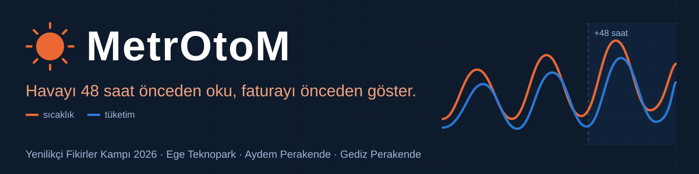
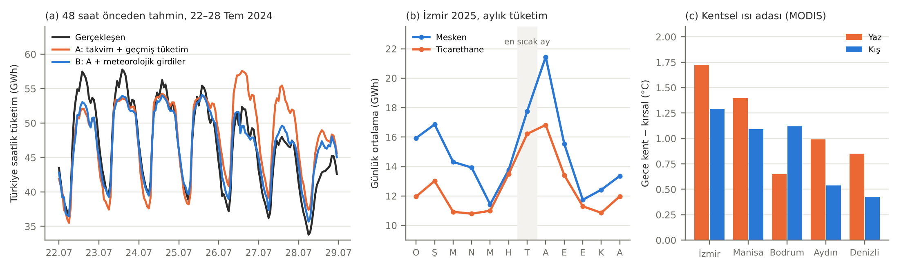
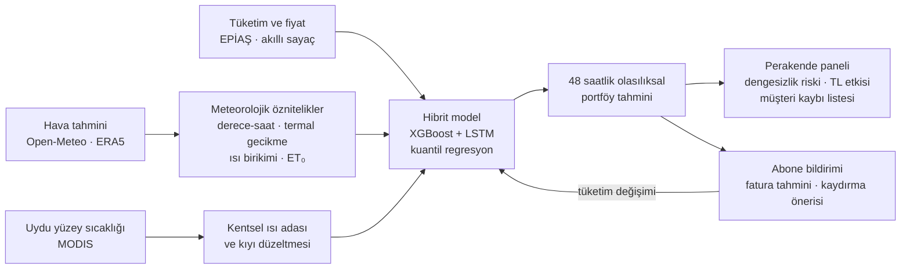

<p align="center">
  
</p>

<p align="center">
  <b>Meteoroloji tabanlı talep tahmini ile perakende elektrik tedarikçileri ve aboneleri için erken uyarı platformu.</b><br>
  <i>Sıcak hava dalgasını 48 saat önceden görüp perakendeciye pozisyonunu, aboneye faturasını önceden gösterir.</i>
</p>

<p align="center">
  
  
  
  
  
</p>

<p align="center">
  <a href="#ön-analizler"><b>Bulgular</b></a> &nbsp;·&nbsp;
  <a href="#nasıl-çalışır">Nasıl çalışır?</a> &nbsp;·&nbsp;
  <a href="#çalıştırma">Çalıştırma</a> &nbsp;·&nbsp;
  <a href="#repo-yapısı">Repo yapısı</a>
</p>

<br>

**Ekip:** Safiye Özkan · Zeynep Dikbaş · Nida Özen · Ceyda Köprülü (Samsun Üniversitesi) · **Tema:** Yapay Zekâ ve Otonom Enerji Sistemleri · **Etkinlik:** Yenilikçi Fikirler Kampı 2026 (Ege Teknopark · Aydem Perakende · Gediz Perakende)

**MetrOtoM**, meteorolojik tahminleri ve iklimsel parametreleri makine öğrenmesiyle birleştirip perakende abone portföyünün saatlik tüketimini 48 saat önceden, belirsizlik aralığıyla birlikte tahmin eder. Tek bir tahmin motorundan iki çıktı üretir:

- **Perakende paneli:** Portföy tahmini, "yarın 14:00–17:00 arası sapma riski yüksek" türünde dengesizlik uyarısı ve tahmini TL etkisi; ay sonu fatura tahminine göre fatura şoku yaşayacak abonelerin müşteri kaybı risk listesi.
- **Abone bildirimi:** "Bu ay faturanız sıcak hava nedeniyle normalin üzerinde gelecek" uyarısı, yıllık 4.000 kWh sınırına yaklaşma bildirimi ve klima ya da sulama pompası kullanımını güneşli, ucuz saatlere kaydırma önerisi.

İki çıktı birbirini besler: aboneler tüketimlerini kaydırdıkça portföy talebi daha öngörülebilir olur, dengesizlik maliyeti ve müşteri kaybı birlikte azalır.

> Bu repo bir **proje fikri ve ön analiz** çalışmasıdır. Tüm analizler başvuru aşamasında **açık verilerle** yapıldı; aboneye ait veri kullanılmadı. Sonuçlar **ön bulgudur**, sınırlılıkları [aşağıda](#varsayımlar-ve-sınırlar) yazılı.

---

## Neden?

| | |
|---|---|
| **Hava, tüketimin en büyük dış etkeni** | İklim değişikliğiyle sıklaşan sıcak hava dalgaları soğutmanın toplam talepteki payını artırıyor ve günlük tüketim rekorlarına yol açıyor ([Ember](https://ember-energy.org/tr/analizler/artan-sogutma-tuketimi-gunes-enerjisi-ve-esneklik-cozumleri-ile-karsilanabilir/rekor-sicakliklar-turkiyenin-elektrik-talebini-tum)). Yanlış tahminin bedeli tedarikçiye dengesizlik maliyeti olarak döner. |
| **Doğru tahminin değeri artıyor** | Mayıs 2026'da üretimde yenilenebilir payı %73'e çıktı ve toptan fiyatlar 2011'den bu yana en düşük seviyeye indi ([Ember](https://ember-energy.org/tr/analizler/yenilenebilir-enerji-turkiyede-devlet-desteginde-750-milyon-dolar-tasarruf-sagladi/)). Güneşli öğle saatleri ucuzladıkça tüketimi o saatlere kaydırmanın değeri büyüyor. |
| **Fatura şoku** | 2026'dan itibaren yıllık 4.000 kWh'i aşan mesken aboneleri devlet desteğinden çıkıp maliyet bazlı tarifeye geçti; bu, 43 milyon abonenin yaklaşık %6'sı ([Habertürk](https://www.haberturk.com/ozel-icerikler/guntay-simsek-1019/3859157-elektrikte-cok-tuketenler-icin-maliyet-bazli-fatura-donemi)). |
| **Müşteri kaybı riski** | Türkiye'de 21 perakende elektrik şirketi var ve tüketici bulunduğu ilden bağımsız olarak istediği şirketle anlaşabiliyor ([Yeni Asır](https://www.yeniasir.com.tr/ekonomi/2026/07/09/elektrikte-serbest-tuketicilige-rekor-ilgi)). Ege'nin dört ilinde ticarethane tüketiminin %57–73'ü zaten serbest tüketicilere ait ([Analiz 3](#ön-analizler)). |

## Bir bakışta

| | |
|---|---|
| Kullanıcı | Perakende elektrik tedarikçisi (enerji alım ve müşteri ilişkileri ekipleri) ve aboneleri |
| Segment | Havaya en duyarlı abone grupları: mesken, ticarethane, tarımsal sulama. Sanayi havaya az duyarlı ([Analiz 3](#ön-analizler)) |
| Bölge | İzmir, Manisa (Gediz Perakende); Aydın, Denizli, Muğla (Aydem Perakende) |
| Veri | Hava: ERA5 ve Open-Meteo · Uydu: MODIS (kentsel ısı adası) · Piyasa: EPİAŞ (tüketim, PTF, SMF) · Pilotta: anonim akıllı sayaç verisi |
| Model | XGBoost + LSTM hibrit, kuantil regresyonla belirsizlik aralığı, segment bazlı |
| Ön test | 2 gün önceki gerçek hava tahminiyle: yaklaşık dengesizlik maliyeti yazın −%13, sıcak hava dalgası günlerinde −%14 |
| Meteorolojik katkı | Termal gecikme, derece-saatler, ısı birikimi, FAO-56 buharlaşma-terleme, kentsel ısı adası düzeltmesi, kıyı–iç kent ayrımı |
| İş modeli (varsayım) | Abone sayısına göre fiyatlanan yıllık yazılım lisansı (SaaS); önce Aydem ve Gediz Perakende'de pilot |

<br>

## Ön analizler

<p align="center">
  
</p>

| # | Analiz ve veri | Bulgu | MetrOtoM'a etkisi |
|---|---|---|---|
| 1 | **Saatlik ön test** — EPİAŞ 2024 Türkiye geneli saatlik tüketim, PTF, SMF; 7 şehrin saatlik hava verisi · [`01`](analysis/01_saatlik_ontest.py) | MAPE %4,66 → %4,41; sıcak hava dalgası günlerinde %4,89 → %4,30. Yaklaşık dengesizlik maliyeti: tüm dönem −%11, yaz −%14, sıcak günler −%22 | Meteorolojik girdiler tahmin motorunun çekirdeği |
| 1b | **Gerçek hava tahminiyle ön test** — aynı veri; test haftalarında her saat için 2 gün önce yapılmış Open-Meteo tahminleri · [`07`](analysis/07_tahminle_ontest.py) | Yaklaşık dengesizlik maliyeti: tüm dönem −%10, yaz −%13,5, sıcak günler −%14. MAPE: yaz %5,38 → %5,12, sıcak günler %4,89 → %4,53. 2 günlük sıcaklık tahmin hatası şehre göre 0,9–1,9°C | Kazanç, sistemin gerçek çalışma koşulunda da büyük ölçüde korunuyor |
| 2 | **Termal gecikme ve ısı birikimi** — aynı veri · [`02`](analysis/02_termal_gecikme.py) | En güçlü ilişki 1–2 saat önceki sıcaklıkla; ısı birikimi etkisi 1–2 gün belirgin, 3–4 günde sönüyor | 2 saatlik gecikme ve çok günlük birikim girdileri |
| 3 | **Segment duyarlılığı** — EPİAŞ il bazlı aylık veri; Manisa, Aydın, Denizli, Muğla; Nisan → Temmuz 2025 · [`03`](analysis/03_segment_duyarlilik.py) | Günlük tüketim: mesken +%30, ticarethane +%75, tarımsal sulama ~6 kat, sanayi +%5 | Mesken, ticarethane ve sulama odaklı segment modelleri |
| 4 | **Aylık hava–tüketim ilişkisi** — İzmir 2025, 12 ay · [`04`](analysis/04_izmir_aylik.py) | Derece-günler ticarethanedeki aylık değişimin %92'sini, meskendekinin %82'sini açıklıyor. Mesken zirvesi en sıcak aydan (Temmuz) bir ay sonra (Ağustos) | Fatura sıcaktan haftalar sonra geliyor: erken uyarı penceresi |
| 5 | **Kentsel ısı adası** — MODIS 1 km yüzey sıcaklığı, 5 şehir, 2024–2025 · [`05`](analysis/05_kentsel_isi_adasi.py), [`gee`](gee/kentsel_isi_adasi.js) | Gece kent–kırsal farkı İzmir'de yazın 1,7°C. Izgara hava verisi İzmir'de yaz gecesi soğutma ihtiyacını yaklaşık %38 düşük gösteriyor | Abone konumuna göre ısı adası düzeltme katsayısı |
| 6 | **Denizellik** — MODIS, kıyı ve iç kentler · [`05`](analysis/05_kentsel_isi_adasi.py) | İç kentlerde ısı adası yazın en güçlü; kıyıdaki Bodrum'da yazın en zayıf (0,7°C), kışın en güçlü (1,1°C) | Kıyı ve iç kentler için ayrı mevsimsel katsayı |

Bütün sayılar [`results/`](results) klasöründeki JSON ve CSV dosyalarından gelir.

**Dürüst okuma:**
- Gerçekleşen hava yerine **2 gün önceki gerçek tahminler** kullanılınca kazancın büyük kısmı korunuyor: yazın neredeyse hiç değişmiyor (maliyet −%13,2'ye karşı −%13,5), sıcak günlerde −%20'den −%14'e iniyor. Sıcak günler tahminin en zor olduğu günler.
- Meteorolojik girdili model 45 haftanın 24'ünde daha iyi (gerçek tahminle 23'ünde). Kazanç her hafta değil, **sıcak dönemlerde** ortaya çıkıyor; MetrOtoM'un değeri de tam bu dönemlerde.
- Mesken tüketiminin Ağustos'ta zirve yapmasını **ısı adası açıklamıyor**: Temmuz her sıcaklık göstergesinde daha sıcak, İzmir'de ısı adasının Temmuz–Ağustos farkı 0,2°C'nin altında. Aynı şehirdeki ticarethanede bu kayma yok. En olası açıklama **sayaç okuma dönemi**; bu, faturanın sıcak dönemden haftalar sonra geldiğini, yani uyarı için zaman olduğunu gösteriyor. Doğrulanması için günlük veya saatlik bölge verisi gerekiyor.
- Kentsel ısı adasının asıl etkisi zamanda değil **mekânda**: aynı hava tahmininde kent merkezindeki aboneye kırsaldakinden daha yüksek tüketim tahmini yapılmalı. İl bazlı aylık tüketime eklendiğinde açıklama gücünü artırmadı (düzeltilmiş R² 0,51 → 0,46).

---

## Nasıl çalışır?



1. **Veri katmanı.** Geçmiş hava için ERA5, 48 saatlik tahmin için Open-Meteo; 2 m sıcaklık, bağıl nem, rüzgâr, bulutluluk, güneş radyasyonu ve yağış. Tüketim ve piyasa tarafında EPİAŞ'ın tüketim, PTF ve SMF verileri. Pilotta Aydem ve Gediz Perakende'nin anonimleştirilmiş akıllı sayaç verisi.
2. **Meteorolojik öznitelikler.** Meteoroloji mühendislerimiz tüketimi fiziksel olarak açıklayan girdileri tasarlar: hissedilen sıcaklık, soğutma ve ısıtma derece-saatleri, termal gecikme (ön testte 1–2 saat), ardışık sıcak günler, çatı GES'ini etkileyen güneşlenme, tarımsal sulama için FAO-56 Penman-Monteith ET₀, kentsel ısı adası düzeltmesi ve kıyı–iç kent ayrımı.
3. **Model.** XGBoost doğrusal olmayan ve ani hava etkilerini, LSTM zamana bağlı örüntüleri ve ısı birikimini öğrenir. Kuantil regresyonla %10–%90 belirsizlik aralığı üretilir. Modeller segment bazında eğitilir.
4. **Karar katmanı.** Perakende paneli ve abone bildirimi. Nihai alım kararı insan onayıyla verilir.
5. **Geri besleme.** Bildirimden sonra tüketimdeki değişim modele geri beslenir; sistem hangi abonenin hangi öneriye yanıt verdiğini öğrenir.

---

## Varsayımlar ve sınırlar

- Analiz 1'de hava girdisi olarak **gerçekleşen** değerler kullanıldı; Analiz 1b bunu 2 gün önceki gerçek model tahminleriyle tekrarlıyor. 1b'de hissedilen sıcaklık iki veri setinde de aynı formülle (BoM) hesaplandığından sayılar Analiz 1'den biraz farklı.
- Saatlik tüketim **Türkiye geneli**dir. Bölge bazlı saatlik veri açık değil; il bazlı veri yalnızca **aylık**.
- Dengesizlik maliyeti PTF ve SMF ile %3 marjlı basitleştirilmiş bir kuralla **yaklaşık** hesaplandı. TL değerleri tüm Türkiye tüketimini tek bir portföy varsayar; **oran** olarak yorumlanmalı.
- Aylık analizler 12 gözleme dayanır.
- MODIS **yüzey** sıcaklığını ölçer; gece hava sıcaklığına yakındır ama aynı değildir. Yalnız bulutsuz günleri ve sabit geçiş saatlerini (≈10:30 ve ≈22:30) görür. %38'lik rakam bu yaklaşıma dayanır.
- Abone davranışının bildirimlere ne kadar yanıt vereceği (H3) henüz sınanmadı; pilot aşamada sınırlı bir abone grubunda ölçülecek.
- Tam projede doğrulama Aydem/Gediz'in bölge bazlı saatlik verisiyle tekrarlanacak.

---

## Çalıştırma

Python 3.13 ile test edildi.

```bash
git clone https://github.com/sayko89/MetrOtoM.git
cd MetrOtoM
python -m venv .venv
source .venv/bin/activate          # Windows: .\.venv\Scripts\Activate.ps1
pip install -r requirements.txt

cd analysis
python 01_saatlik_ontest.py        # saatlik ön test, ~3 dk
python 02_termal_gecikme.py        # 01'in çıktısını kullanır
python 03_segment_duyarlilik.py
python 04_izmir_aylik.py
python 05_kentsel_isi_adasi.py
python 06_sekil.py                 # Şekil 1, 01 ve 04'ün çıktısını kullanır
python 07_tahminle_ontest.py       # 2 gün önceki gerçek tahminlerle ön test, ~5 dk
```

MODIS verisini yeniden üretmek için [`gee/kentsel_isi_adasi.js`](gee/kentsel_isi_adasi.js) dosyasını [Google Earth Engine Code Editor](https://code.earthengine.google.com)'a yapıştırıp **Run**'a basın; **Tasks** sekmesinden `metrotom_isi_adasi` işini başlatın, CSV Google Drive'a iner.

## Repo yapısı

| Dosya | Amaç |
|---|---|
| [`analysis/ortak.py`](analysis/ortak.py) | Veri yükleme yardımcıları |
| [`analysis/01_saatlik_ontest.py`](analysis/01_saatlik_ontest.py) | Haftalık genişleyen pencereyle XGBoost; 48 saat önceden tahmin, dengesizlik maliyeti |
| [`analysis/02_termal_gecikme.py`](analysis/02_termal_gecikme.py) | Saat ve gün ölçeğinde gecikme ve ısı birikimi |
| [`analysis/03_segment_duyarlilik.py`](analysis/03_segment_duyarlilik.py) | Ege'nin 4 ili, Nisan → Temmuz 2025, segment ve serbest tüketici payı |
| [`analysis/04_izmir_aylik.py`](analysis/04_izmir_aylik.py) | İzmir 2025 aylık hava–tüketim regresyonu, Temmuz–Ağustos göstergeleri |
| [`analysis/05_kentsel_isi_adasi.py`](analysis/05_kentsel_isi_adasi.py) | Kentsel ısı adası, denizellik, ızgara verisi düzeltmesi |
| [`analysis/06_sekil.py`](analysis/06_sekil.py) | Şekil 1 |
| [`analysis/07_tahminle_ontest.py`](analysis/07_tahminle_ontest.py) | Eğitim gerçekleşen havayla, test 2 gün önceki gerçek tahminlerle |
| [`gee/kentsel_isi_adasi.js`](gee/kentsel_isi_adasi.js) | Google Earth Engine: MODIS ile kent ve kırsal gece/gündüz yüzey sıcaklığı |
| [`data/`](data) | EPİAŞ, Open-Meteo (gerçekleşen ve 2 gün önceki tahmin) ve MODIS verileri |
| [`results/`](results) | Analiz çıktıları (JSON, CSV) |
| [`figures/`](figures) | Grafikler |
| [`assets/`](assets) | README görselleri |

## Veri kaynakları

| Veri | Kaynak |
|---|---|
| 2024 saatlik gerçek zamanlı tüketim, PTF, SMF | [EPİAŞ Şeffaflık Platformu](https://seffaflik.epias.com.tr) |
| İl bazlı aylık tüketim miktarları (profil grubuna göre, 2025) | EPİAŞ Şeffaflık Platformu › Elektrik Tüketim › Tüketici Bilgisi › Tüketim Miktarları (veri kaynağı: dağıtım şirketleri) |
| Saatlik hava verisi, 7 şehir, 2024–2025 | [Open-Meteo Historical Weather API](https://open-meteo.com) (CC BY 4.0) |
| 2 gün önceki hava tahminleri, 7 şehir, Mart–Aralık 2024 | [Open-Meteo Previous Runs API](https://open-meteo.com/en/docs/previous-runs-api), `*_previous_day2` değişkenleri (CC BY 4.0) |
| Yüzey sıcaklığı, arazi örtüsü, yükseklik | NASA MODIS MOD11A2 v061 ve MCD12Q1, SRTM; [Google Earth Engine](https://earthengine.google.com) üzerinden |

EPİAŞ verileri kaynak gösterilerek kullanılabilir. Veriler bu repoda yalnızca analizlerin tekrarlanabilmesi için bulunur.

**Yöntem kaynakları:** Allen vd. (1998) FAO-56 · Hersbach vd. (2020) ERA5, *QJRMS* 146(730) · Chen ve Guestrin (2016) XGBoost, *KDD '16* · Hochreiter ve Schmidhuber (1997) LSTM, *Neural Computation* 9(8) · Hong ve Fan (2016) olasılıksal yük tahmini, *IJF* 32(3).

<br>

## Ekip

**Safiye Özkan** (Yazılım Mühendisliği) · **Zeynep Dikbaş** (İklim Bilimi ve Meteoroloji Mühendisliği) · **Nida Özen** (İklim Bilimi ve Meteoroloji Mühendisliği) · **Ceyda Köprülü** (İklim Bilimi ve Meteoroloji Mühendisliği)

Samsun Üniversitesi

<p align="center"><sub>MetrOtoM · Yenilikçi Fikirler Kampı · 2026</sub></p>
